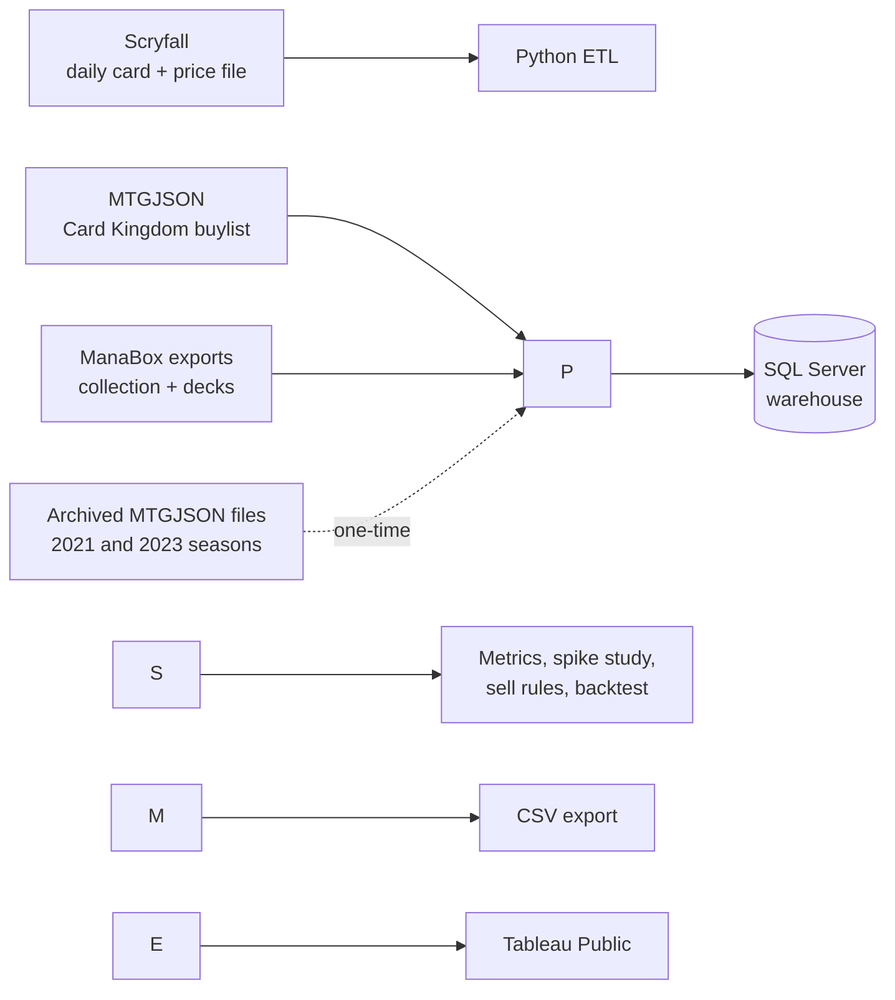

# MTG Sell Signal

**When should I sell the Magic: The Gathering cards I'm not using?**

An automated price-analytics pipeline that tracks every paper Magic card daily, reconciles my collection against my decks, and flags each spare card as **Sell now**, **Watch** or **Hold**. The rules are backtested against three separate market seasons.

[**View the live dashboard on Tableau Public →**](https://public.tableau.com/views/MTGDashboards/WhatShouldISell?:language=en-US&publish=yes&:sid=&:redirect=auth&:display_count=n&:origin=viz_share_link)

`Python` · `SQL Server (T-SQL)` · `Tableau` · `Windows Task Scheduler` · free public data only

\---

## Results

The sell rules were backtested on about 449,000 card observations: every card worth $2 or more, on 15 weekly dates in three market seasons. For each card, the test compared the signal the rules would have given on that date with what the price actually did over the next 30 days.

|Season|"Sell now" cards: median change, next 30 days|"Sell now": share that fell 10%+|"Hold": share that fell 10%+|
|-|-|-|-|
|Oct 2021 – Jan 2022|−3.5%|32%|9%|
|Feb – May 2023|−7.0%|42%|10%|
|Jul 2026 – now|−10.2%|51%|6%|

* **The rules held in every season.** The signals ranked the same way each time (Sell now < Watch < Hold < Hold (rising)). "Sell now" cards were 3 to 8 times as likely as "Hold" cards to lose 10% or more.
* **Pre-order prices are the clearest sell.** Cards priced before their set's release fell a median **34%** in the following month.
* **Most price spikes don't crash.** 82% of +25% spikes did *not* fall 10% or more the following month. The risky spikes are the ones that have started cooling: 32–36% of those fell 10% or more.
* **New-set chase cards rarely hold value.** Across 11 sets, the 10 most valuable cards sat at about 70% of their early price within three months of release, and held their value in only 1 set.
* **When Card Kingdom's buylist pays at or above market price, hold.** Only 3% of those cards fell 10% or more. The buylist price is a leading indicator of demand.

*Numbers update weekly as the study reruns on new data; the dashboard shows the current figures.*

\---

## How it works



**Daily (Windows Task Scheduler):**

1. **`load\_scryfall.py`** downloads Scryfall's bulk file of every printing, filters it to English paper cards, and loads cards, sets and prices.
2. **`load\_buylist.py`** loads Card Kingdom's buylist (what a store will actually pay) from MTGJSON.
3. **`import\_manabox.py`** imports my collection and deck lists from ManaBox exports synced through Google Drive.
4. **`refresh\_analytics.py`** rebuilds the price metrics. Each week it also reruns the spike study and backtest so the rules learn from new history.
5. **`export\_tableau.py`** writes the dashboard datasets to CSV, since Tableau Public can't connect to SQL Server.

Every step logs to one file and runs even if an earlier step fails, so one problem doesn't hide another. [`RUNBOOK.md`](RUNBOOK.md) covers operations, checks and recovery.

\---

## Design decisions

* **Change-only price history.** Most card prices don't move on a given day, so `dw.fact\_price` stores a new row only when a price changes (`valid\_from` / `valid\_to`, like a Type 2 slowly changing dimension). That keeps years of daily history for every printing small enough for a laptop.
* **No lookahead.** `dw.usp\_build\_card\_metrics @as\_of` rebuilds every metric using only prices known on that date. The study and backtest replay past dates through this same procedure.
* **One rules function for both live signals and backtest.** `dw.fn\_sell\_signal` is an inline table-valued function, so the dashboard's signals and the backtest can't drift apart.
* **Rules come from evidence, not guesses.** Spikes are classified by speed (sharp/gradual), momentum (still rising/cooling/flat) and breadth (did other printings move?), and compared against peer groups (set age × rarity × price tier). The backtest has already changed a rule: "Card Kingdom pays at or above market" started as a sell signal, the data showed those cards *rose*, and it became a hold signal.
* **Gaps stay gaps.** Archived price files from the Wayback Machine add 2021 and 2023 seasons. The years between them have no data, and none is invented. The study only uses dates with 30 days of real prices both before and after.
* **The collection is the only source of truth for ownership.** Deck lists say what is needed; the collection says what is owned. Cards owned beyond what my decks need are the sell candidates.
* **Dashboard text is built in SQL.** The finding sentences on the dashboard are generated from the same results as the charts (`dw.vw\_dashboard\_findings`), so the text can never disagree with the numbers.

\---

## Limitations

* **The backtest is in-sample.** The spike and peer statistics the rules use come from the same dates being tested, so results are somewhat optimistic. As daily history grows, newer dates can be tested against statistics from older ones.
* **Market price = TCGplayer market price** (via Scryfall and MTGJSON). Real sale prices vary by condition and venue.
* **For the archived seasons, "other printings" is based on today's card list,** so reprints released later count slightly early. This only affects the spike breadth label.
* **The local-store estimate is a rule of thumb** (a share of market price); the Card Kingdom figure is a real buylist offer.

\---

## Roadmap

* **Collection workbook:** whole-collection value, deck usage, and set-level views.
* **Pack-buy recommendation:** expected value of opening a pack versus buying the singles.
* **Buy-card recommendation:** when to buy the cards my decks still need, using the same price-pattern evidence.
* **Bulk breakout study:** which cheap cards tend to become valuable.
* **Out-of-sample backtest** once enough new daily history has built up.

\---

## Running it yourself

Requirements: Windows, Python 3.10+, SQL Server (Express or Developer edition is fine) and the Microsoft ODBC Driver for SQL Server.

```
pip install -r requirements.txt
copy ETL\\config.example.ini ETL\\config.ini      (then fill in your server and export folder)
```

Run `sql/01` through `sql/11` in SSMS, then follow **Rebuilding from scratch** in [`RUNBOOK.md`](RUNBOOK.md).

## Repository layout

```
ETL/      Python loaders, analytics refresh, Tableau export
sql/      warehouse schema, procedures and views, run in numbered order
RUNBOOK.md  operations guide
run\_daily\_load.bat  daily pipeline (Task Scheduler entry point)
```

\---

## Data sources and credits

* [Scryfall](https://scryfall.com/docs/api): card data, prices and images
* [MTGJSON](https://mtgjson.com): Card Kingdom buylist and historical prices
* [Internet Archive Wayback Machine](https://web.archive.org): archived MTGJSON price files
* [ManaBox](https://manabox.app): collection and deck exports

*MTG Sell Signal is unofficial Fan Content permitted under the Wizards of the Coast Fan Content Policy. It is not approved or endorsed by Wizards. Portions of the materials used are property of Wizards of the Coast. © Wizards of the Coast LLC.*

*Not financial advice: card prices are volatile, and past patterns don't guarantee future moves.*

